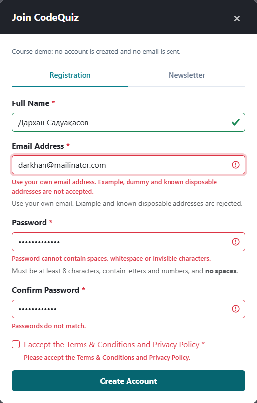
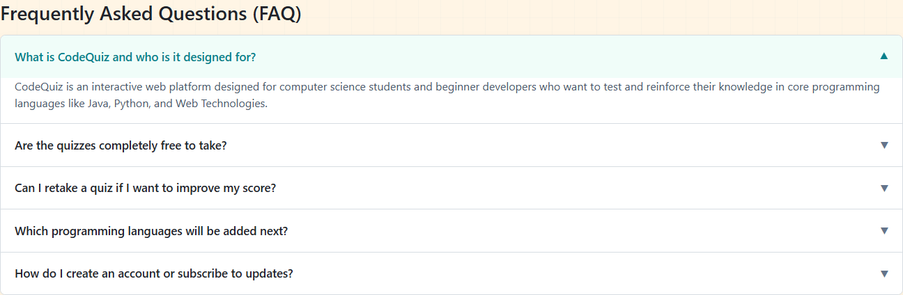
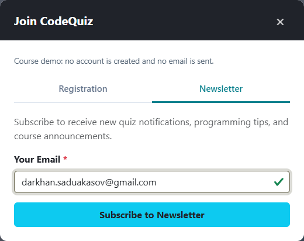
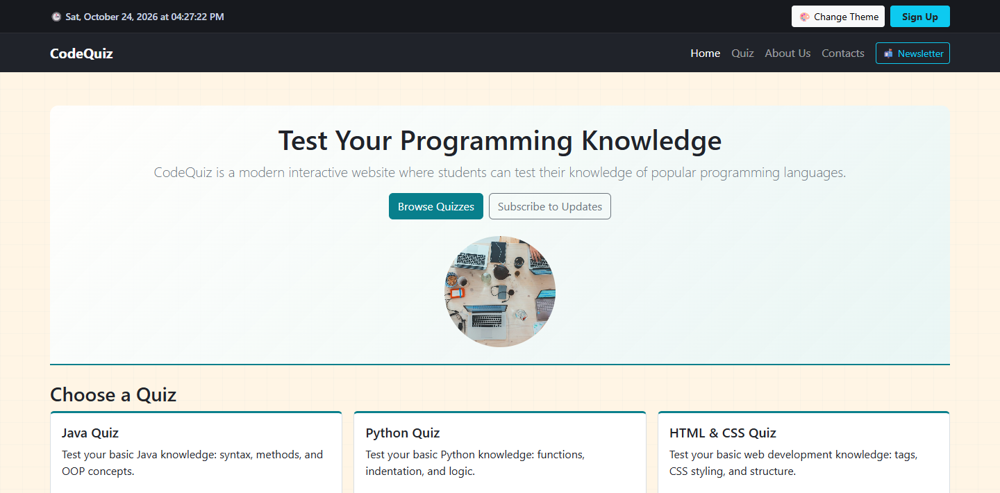
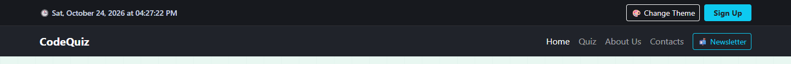
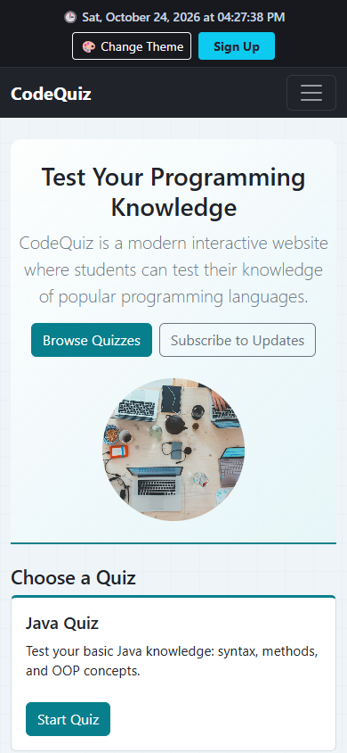
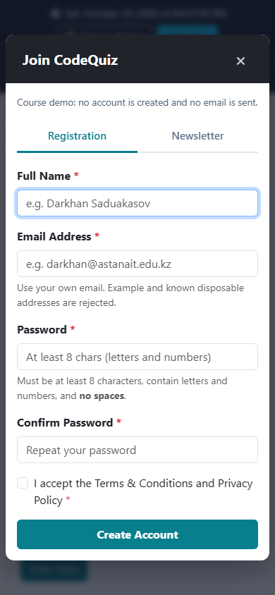
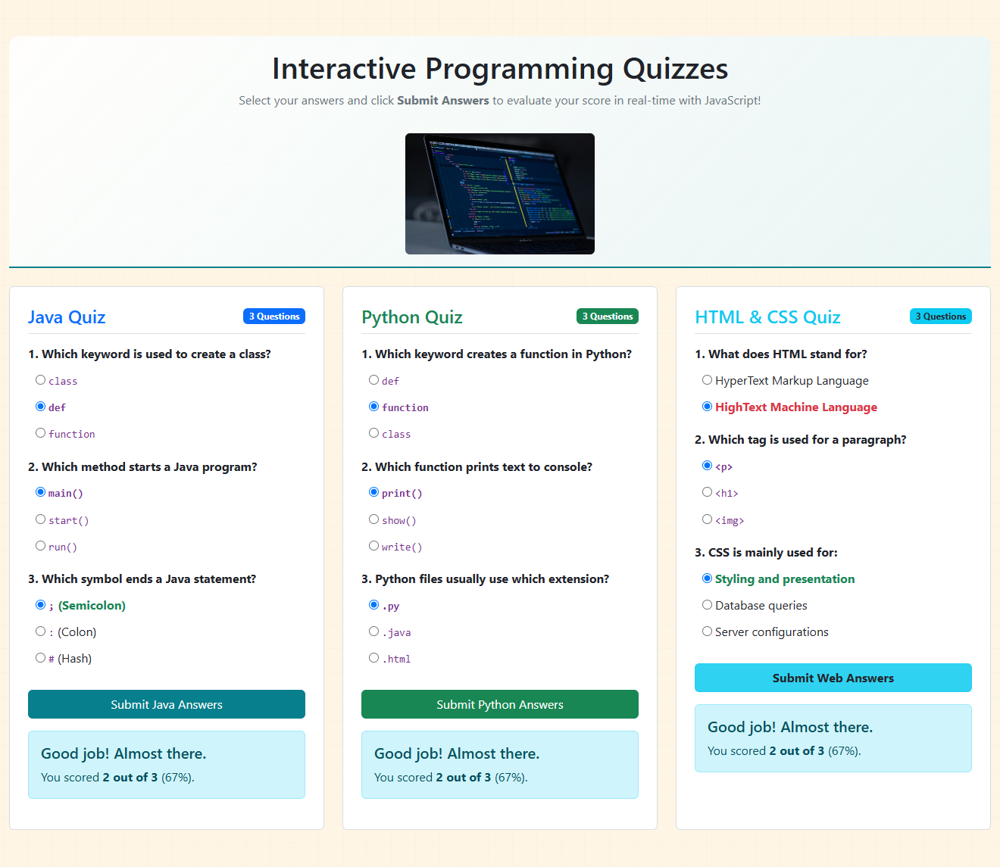

# CodeQuiz - Assignment 4: Introduction to JavaScript

**Team:** CodeQuiz  
**Members:** Darkhan Saduakasov; Kassymkhan  
**Group:** [ENTER YOUR REAL GROUP]  
**Deployed URL:** [PUBLISH, VERIFY AND ENTER THE REAL URL]  
**Status:** local project and report prepared; group and online deployment pending.

## Objective

Extend the existing four-page CodeQuiz website with JavaScript form validation, an FAQ accordion, popup forms, dynamic backgrounds and a live Date-based clock. Preserve the previous pages, content and quizzes.

## Task 1 - Form validation

1. Handle submit with preventDefault().
2. Check all required fields and display individual messages.
3. Revalidate edited fields and password confirmation.
4. Focus the first invalid field; for valid input show a local-demo success and reset.

Name: at least two letters, supported Unicode names and separators. Email: valid local/domain syntax, no dummy/example or known disposable addresses, and provider typo checks. Password: eight or more characters with a letter and number; no whitespace/invisible characters on typing, paste, drop or submit. Confirmation: exact raw match. Agreement: required.

Email input checking cannot prove mailbox existence or ownership. Real verification needs a backend and an email link/code. These forms do not create accounts, send mail or store passwords/personal details.

## Task 2 - FAQ accordion

1. Keep all five answers hidden on initial load.
2. Handle question button clicks.
3. Update active, aria-expanded, aria-hidden and maxHeight using scrollHeight.
4. Animate in CSS; close previous answers and recalculate open height on resize.

## Task 3 - Popup subscription form

1. Hide and deactivate the overlay by default.
2. Open Registration or Newsletter from its trigger.
3. Move focus inside, trap Tab, and prevent background interaction.
4. Close using X, backdrop or Escape and restore focus.

Newsletter shares the email validator. Tabs support arrow keys, Home and End.

## Task 4 - Background colour

1. Store five programming-themed colour objects in a palette array.
2. Advance with (index + 1) % palette.length.
3. Update document.body.style.backgroundColor.
4. Save the optional theme index and show a status notification. Catch storage exceptions.

## Task 5 - Date and time

1. Read time with new Date().
2. Format using Intl.DateTimeFormat.
3. Update a time element and datetime attribute every second with setInterval().

The clock uses the viewer's local time zone.

## Testing and preservation

14 test groups passed in Chrome 155.0.8059.85; transport: offline file URLs. All four pages, local assets, both footer names, clock ticks, theme cycling/persistence, blocked storage, FAQ, popup dismissal/focus, empty and valid forms, malformed/dummy/disposable emails, password whitespace, contact input escaping and all quiz scoring paths were exercised. Widths: 360, 390, 768 and 1440 px.

The original pages, content sections, question/answer choices, galleries, grids, tables, profiles and four PNG assets remain. Details: CHANGELOG.md. Results: test-results.json.

Firefox and Edge could not launch in the restricted Windows environment; those browsers are not claimed as tested. The runner supports Firefox on an unrestricted machine. Viewport emulation is not a physical-device test. Recheck the deployed site in another browser and on a real phone.

## Part 2 - Deploy

Follow ../DEPLOYMENT.md. Copy into the existing shared repository, review/commit/push, publish with GitHub Pages or Netlify, verify the assigned public URL and add it above. **Online deployment has not been performed in this task.**

## Existing team roles

- Darkhan Saduakasov: Home and Quiz; Task 1 validation, Task 5 clock and quiz scoring.
- Kassymkhan: About Us and Contacts; Task 2 FAQ, Task 3 popup, Task 4 backgrounds.

Each member must understand every component, submit the required files and prepare for the practice lesson. See ../DEFENSE.md.

## Reflection

HTML supplies structure, CSS supplies responsive appearance and transitions, and JavaScript responds to user events. Shared validation prevents inconsistent forms. Browser checks revealed and helped correct focus, checkbox-layout and mobile-table defects. Frontend validation and real account/email verification have different responsibilities.

## Before submission

Fill the real group. Publish and verify the URL. Save the edited PDF report. Submit the report and archive by the LMS deadline and prepare for the defense.
