# Assignment 5 - CodeQuiz

**Team:** Team Spirit  
**Members:** Darkhan Saduakasov; Kassymkhan  
**Group:** SE 2508  
**Website URL:** ____________________

## Objective

Extend the previous CodeQuiz website with DOM manipulation, event handling, objects, arrays, higher-order functions, sound and animations. Add a study planner, topic filters and a thumbnail gallery that support the programming quiz theme.

## 1. DOM manipulation and styling

1. Select individual elements by ID and groups with querySelectorAll and jQuery selectors.
2. Update the plan summary, result text and available-topic count when the user interacts.
3. Change the background with the theme button and update visibility and selection styles.
4. For the thumbnail-gallery option, read the selected thumbnail attributes and change the main image src, alt and caption.

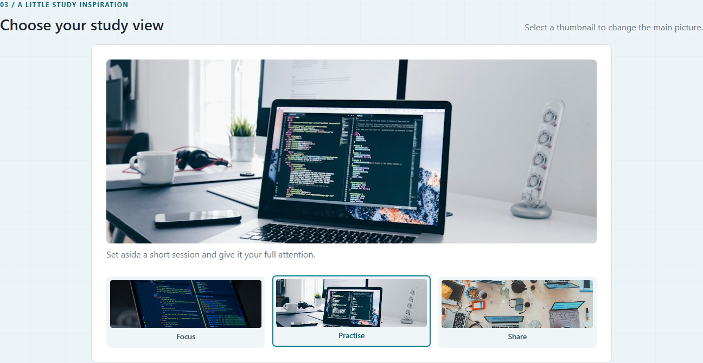

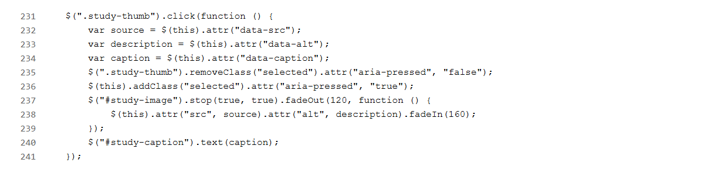

## 2. Button events and callbacks

1. Handle the Next and Back buttons to move through the three form steps.
2. Pass updateStep to showStep as a callback to update progress and the visible controls.
3. Keep entered values in their fields when moving back and validate the current step before continuing.
4. Attach a native addEventListener click handler to Reset plan to clear fields, object properties and the result.

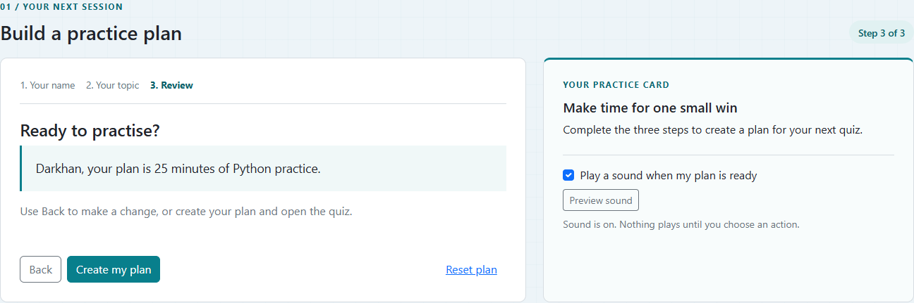

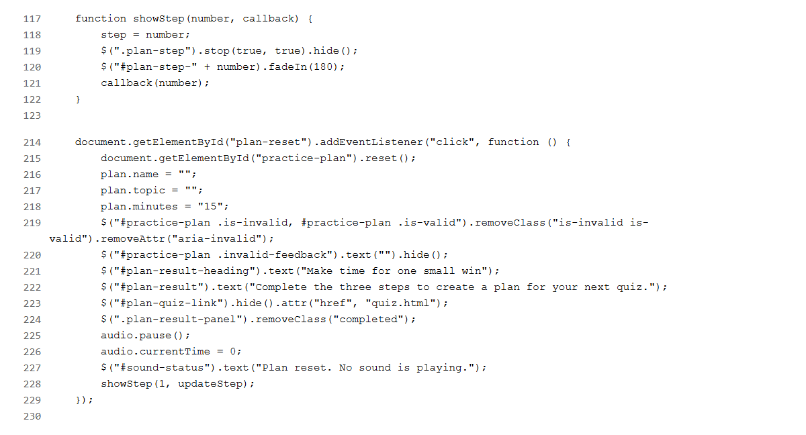

## 3. Keyboard events and switch

1. Select the menu links and attach keydown event listeners.
2. Find the focused menu item and use switch(event.key) to handle the arrow keys.
3. Move focus to the next or previous item and wrap at either end of the menu.
4. Use Enter to open the focused link. Apply a second switch to display the selected topic label.

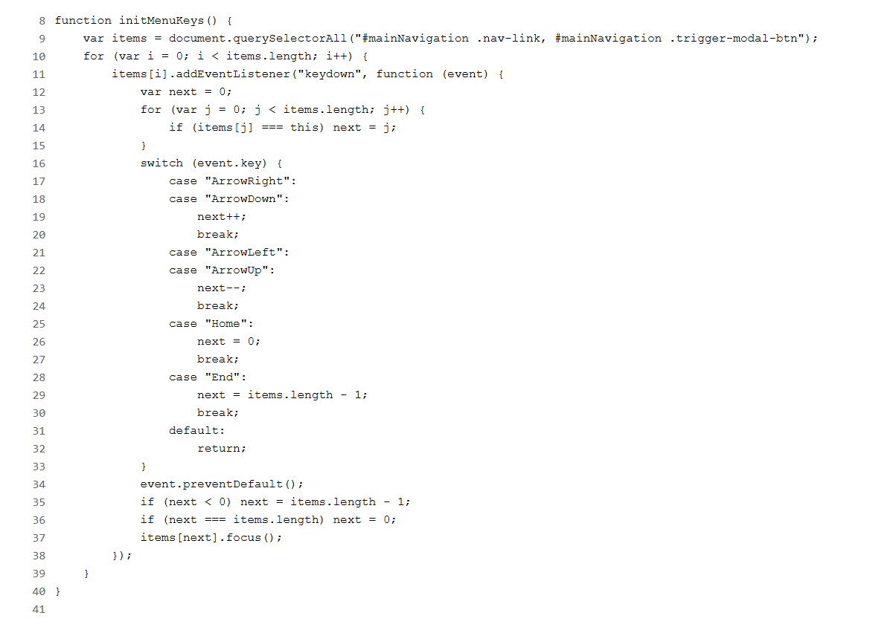

## 4. Objects, arrays and higher-order functions

1. Store the learner name, topic and session length in the plan object.
2. Call the summary method to display those object properties in the review and result.
3. Store quiz topics in an array of objects and use a for loop to generate topic cards.
4. Pass matchesCategory to topics.filter() to display only the selected category. This is the higher-order function.

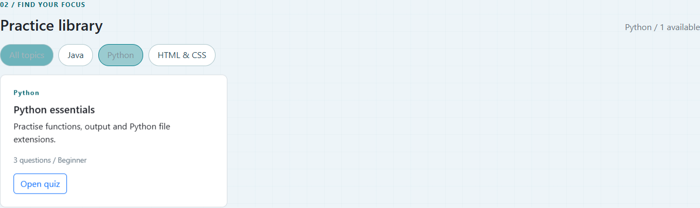

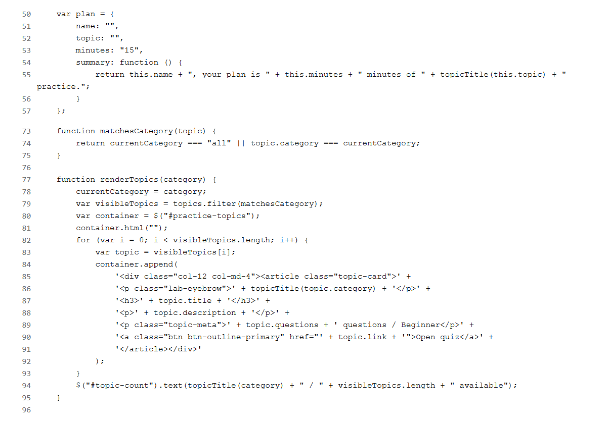

## 5. Sound effects

1. Add one local notification sound to an audio element.
2. Play the sound when Preview sound is clicked or a practice plan is created.
3. Pause and rewind the same audio element before replaying it to avoid overlapping sounds.
4. Stop playback when sound is disabled or the plan is reset.

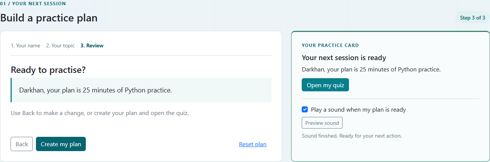

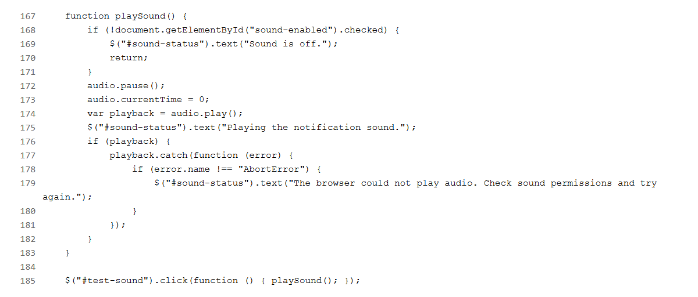

## 6. Event-triggered animations

1. Use fadeIn when moving between planner steps.
2. Fade the gallery image out, change its attributes in the callback and fade it back in.
3. Use css and animate to fade the completed-plan result to full opacity.
4. Use stop(true, true) before starting another animation so rapid actions do not build up a queue.

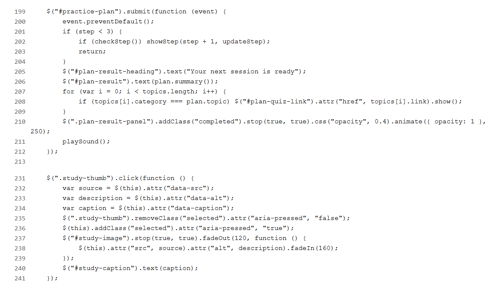

## 7. Structure and user experience

1. Keep the page structure in HTML, presentation in separate CSS files and behaviour in separate JavaScript files.
2. Load jQuery before the custom scripts and use named functions for repeated actions.
3. Use labelled form fields, visible feedback, menu keyboard navigation and responsive layouts.
4. Keep the new planner, filters, gallery and sound controls connected to the CodeQuiz learning theme.

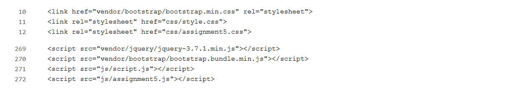

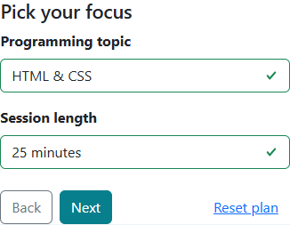

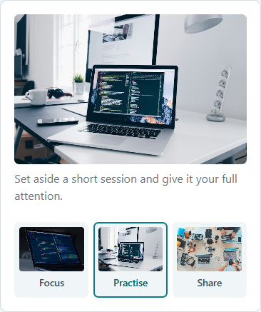

## Reflection

We connected the new study planner and topic filters to the existing quizzes. Keeping input values while moving between form steps was a challenge; hiding panels and using a shared plan object preserved the data. Reusing one audio element prevented sounds from overlapping. This work helped us practise callbacks, objects and DOM updates.
