# Assignment 6 - CodeQuiz

Team: Team Spirit
Members: Darkhan Saduakasov; Kassymkhan
Group: SE 2508
Website: https://arxqar-jpg.github.io/WEB-Technologies/index.html

Published and verified on 5 November 2026 (Asia/Qyzylorda).
Repository: https://github.com/arxqar-jpg/WEB-Technologies
Implementation commit: https://github.com/arxqar-jpg/WEB-Technologies/commit/b8f810f64451221357375df49f1472b037fff91e

## Task 0 / jQuery setup
1. Add the required jQuery 4.0.0 CDN script in the head of all five HTML pages. Keep a local copy of the same version as an offline fallback.
2. Use an external $(document).ready() block in js/script.js and print jQuery is ready! in the browser console.
3. Load the custom scripts after jQuery. Replace the old event shorthand calls with .on() for jQuery 4 compatibility. The browser tests confirmed the ready message, CDN HTTP 200 and offline initialization on every page.

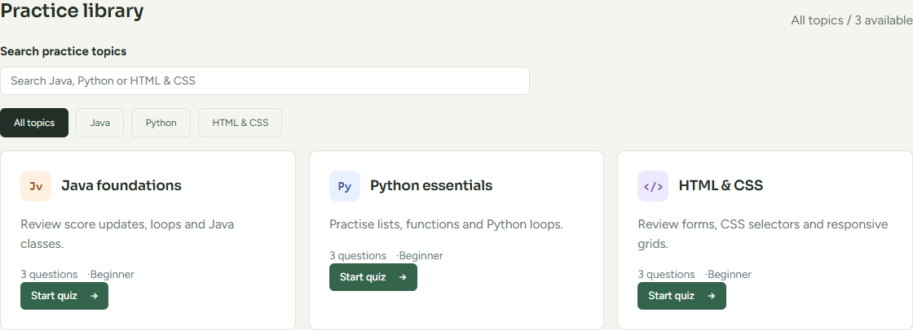
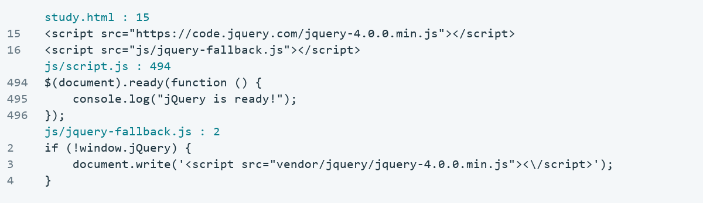

## Tasks 1-2 / Live search and autocomplete
1. Task 1: type into Overview or Study Lab > Practice library > Search practice topics. Filter the existing topic objects by title/description while preserving the selected category.
2. Rebuild the matching cards immediately on input, update the result count and show a no-results message when necessary. Clearing the search restores the selected category.
3. Task 2: display matching topic titles in a dropdown. Selecting a suggestion completes the search. Arrow keys and Enter select suggestions; Escape closes the dropdown and preserves the query.

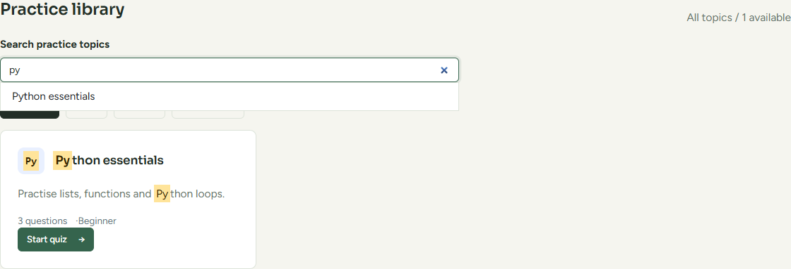
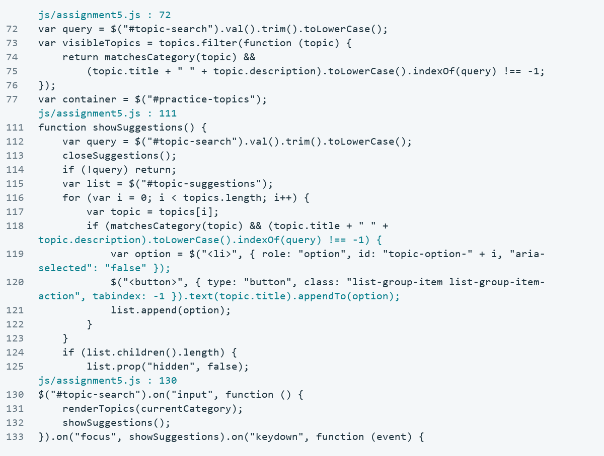

## Task 3 / Search highlighting
1. After rendering results, find every literal case-insensitive match in the result-card text, including the title and description.
2. Escape regular-expression characters in the query. Walk text nodes and create mark elements with textContent; user input is not inserted as HTML.
3. Re-render cards for each search so previous highlights disappear and nested marks do not accumulate. The Python result contains two highlighted occurrences.

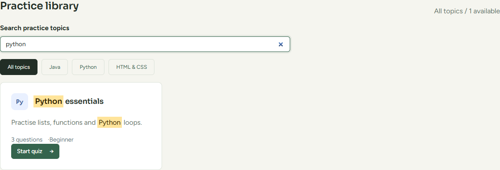
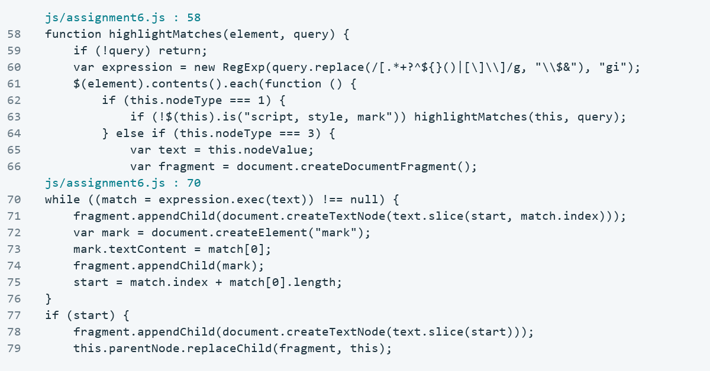

## Tasks 4-5 / Scroll progress and number counters
1. Task 4: show a fixed gradient progress bar at the top of each page. Divide scrollTop by the available scroll distance and update the fill width and aria-valuenow on scroll/resize.
2. Task 5: animate the existing Study Lab totals from zero to 3 topics, 9 original quiz questions and 3 planner steps. These are actual project totals.
3. Start each counter once when it enters view and honor reduced-motion preferences. Tests checked intermediate values and exact final totals.

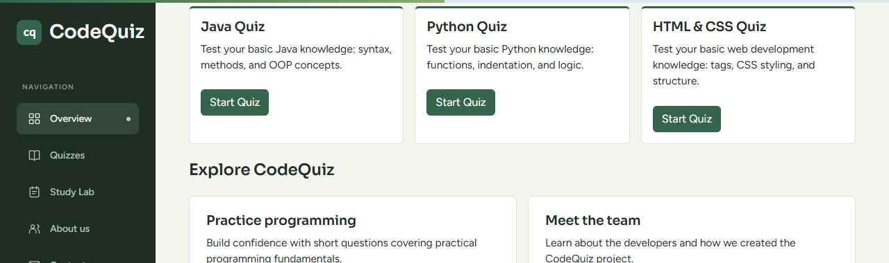
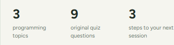
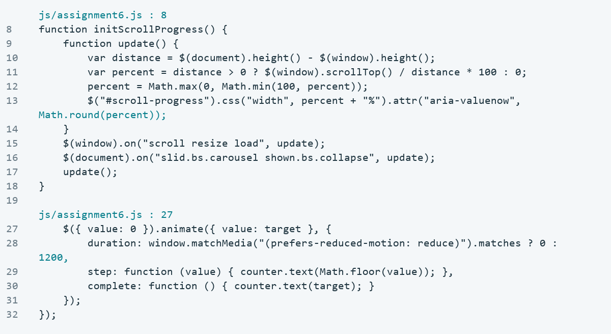

## Tasks 6-7 / Submit spinner and notifications
1. Task 6: after validation succeeds in registration, newsletter or contact, disable its Submit button and show a spinner with Please wait... for 1.2 seconds.
2. Use a submitting flag to block repeated submissions. Then perform the original reset/success feedback and restore the button label and enabled state. Invalid forms show their usual field errors immediately.
3. Task 7: show a temporary success toast and fade it out automatically. Clear earlier animation queues when a new notification replaces the previous one.

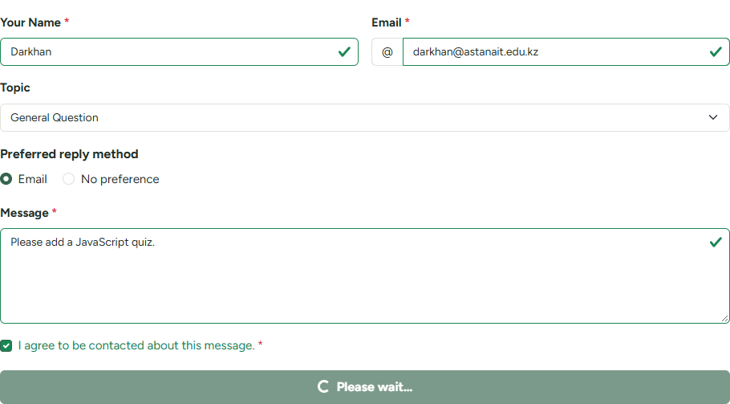

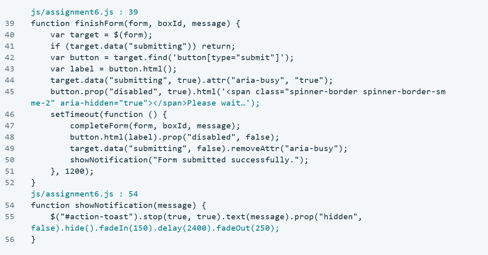

## Task 8 / Copy plan to clipboard
1. Create a practice plan, then click Copy plan beside the generated summary. Copy the exact summary using the Clipboard API, with a textarea fallback for unsupported/denied access.
2. After a successful copy, change the button to a checkmark and Copied, show the Copied to clipboard! tooltip and a notification, then restore the label.
3. Do not claim success if both methods fail. Resetting the plan hides the Copy button and clears its feedback. Tests included real clipboard readback, fallback copying and the failure path.

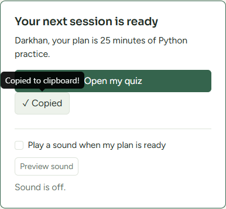
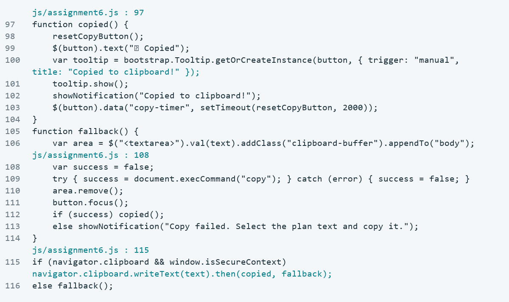

## Task 9 / Image lazy loading
1. Keep each image URL in data-src and use a tiny placeholder initially. On scroll/resize, use jQuery visibility, offset and viewport boundaries to assign src only for images in view.
2. Recheck images when the carousel changes slides or a collapsed area opens. The nine carousel images load as their slides become visible.
3. When a gallery thumbnail changes the main image explicitly, remove the old lazy source so later scrolling cannot overwrite the selected picture. Tests recorded no offscreen request before scrolling and a real image request after exposure.

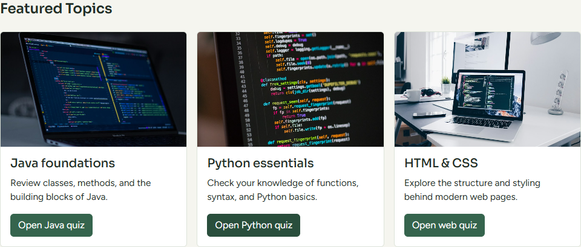
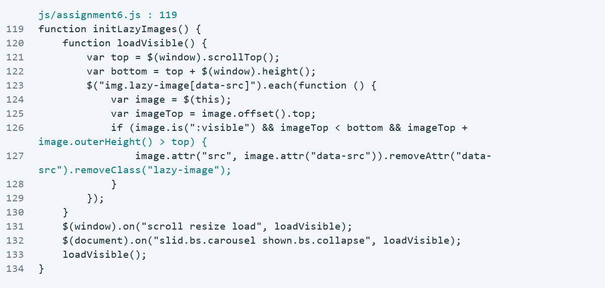

## Verification
51 groups passed: 19 Assignment 6, 25 regression and 7 platform groups; no JavaScript page errors.

## Deployment
Published and verified on 5 November 2026 (Asia/Qyzylorda). Six live groups passed; 12 public source/font files matched the committed project. See live-verification.json.
Repository: https://github.com/arxqar-jpg/WEB-Technologies
Implementation commit: https://github.com/arxqar-jpg/WEB-Technologies/commit/b8f810f64451221357375df49f1472b037fff91e
Pages build: https://github.com/arxqar-jpg/WEB-Technologies/actions/runs/41895949494
LMS upload and defense remain the responsibility of each team member.
